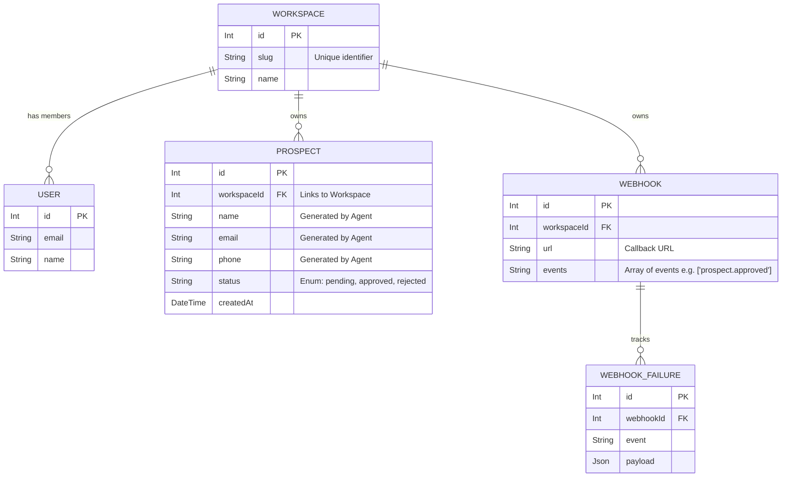

# Pugu: Database Architecture (Pugu Integration)

This document maps out the core entity relationships for `pugu`, specifically highlighting how the Pugu POC (`Prospects`) integrates into the existing PostgreSQL schema via Prisma.

## 🗄️ Entity-Relationship Diagram

## 🔄 Pugu Flow in the Main App
1. **Agent Submission:** AI Agent sends `POST /api/v1/prospects` authenticated via `ApiKey`.
2. **Database Insert:** Prisma creates a new `Prospect` record linked to the `Workspace` with `status = "pending"`.
3. **Dashboard Real-time:** SvelteKit frontend (`apps/web/src/routes/pugu`) listens via Server-Sent Events (SSE) or polls the API to display new rows instantly.
4. **Human Approval:** User clicks "Approve". UI sends `PATCH /api/v1/prospects/:id`.
5. **Webhook Trigger:** The `apps/api` server updates the `Prospect` status, looks up active `Webhook` configurations for the workspace, and dispatches the payload to the AI Agent.
