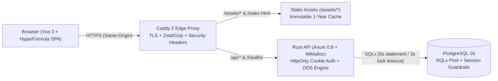

<div align="center">

# Pugu

**Open-Source Local-First Workspace for Structured Databases, Spreadsheets & Knowledge Graphs**

[-f59e0b)](https://github.com/Poohmuhahaha/pugu-teenueng)
[](https://github.com/Poohmuhahaha/pugu-teenueng/actions/workflows/ci-cd.yml)
[](LICENSE)
[](https://github.com/tokio-rs/axum)
[](https://vuejs.org)
[](https://www.postgresql.org)
[](https://caddyserver.com)

</div>

> [!WARNING]
> **Project Status: Active Development (Work in Progress / Pre-Alpha)**
> Pugu is currently under heavy active development and is **not yet feature-complete**. Core architecture, database schemas, API contracts, and UI workflows may change frequently before the first stable release (`v1.0.0`).

---

## Overview

**Pugu** is a fast, self-hostable workspace that unifies **structured database collections**, a **LibreOffice Calc-compatible spreadsheet engine**, **rich document notes**, and a **bidirectional knowledge graph** in one cohesive web application.

### Key Features

- **Structured Database Collections** — Define custom schemas (`text`, `number`, `select`, `date`, `checkbox`, `url`, `formula`, `relation`) with instant filtering, sorting, grouping, and inline editing.
- **Full-Page Spreadsheet Engine (`.ods` / `.csv` + OpenFormula)** — Powered by **HyperFormula** on the client and a native Rust `.ods` / `.csv` parser (`server/src/ods.rs`), supporting multi-sheet workbooks, merged cells, conditional formatting, pivot tables, charts, and cross-entry formulas (`=ENTRY()`).
- **Bidirectional Knowledge Graph (`[[Wiki-Links]]`)** — Link entries, notes, and spreadsheets together with automatic backref indexing (`server/src/store.rs`) and interactive force-directed graph visualization (`GraphPage.vue`).
- **Lead Desk & Command Center** — Unified dashboard for pinned views, recent activity, quick entry creation, and cross-workspace navigation.
- **Multi-Tenant Workspaces & RBAC** — Organize teams into isolated workspaces with role-based permissions (`Owner`, `Editor`, `Viewer`).

---

## System Architecture

Pugu is architected around a **Same-Origin Reverse Proxy Topology** and an end-to-end **Rust → TypeScript Contract Pipeline**:



### Engineering Highlights

| Layer | Technology & Standards |
| :--- | :--- |
| **Edge / Reverse Proxy** | **Caddy 2** (`deploy/Caddyfile`, `apps/Caddyfile`) — TLS termination, `zstd`/`gzip` compression, `HSTS`/`CSP`/`X-Frame-Options` headers, `immutable` cache on `/assets/*`, `no-store` on `/index.html`, unbuffered SSE on `/api/agent/stream/*`, and active `/healthz` checks. |
| **Frontend SPA** | **Vue 3.5** (`<script setup lang="ts">`) + **TanStack Query v5** + **HyperFormula** + **Tailwind CSS** semantic design tokens (`apps/`). Every data view enforces explicit **4-State UI** (`isPending`, `isError`, `isEmpty`, `data`). |
| **Type-Safe Contract** | **ts-rs** exports Rust DTOs (`#[derive(TS)]`) directly to `apps/src/api/types/`. **Zod** schemas in `apps/src/api/schemas/` enforce compile-time equality (`AssertEqual<ZodType, TsRsType>`) and runtime boundary validation. |
| **Authentication** | **HttpOnly + Secure + SameSite=Lax** session cookies (`axum-extra`) paired with a client-side **single-flight `401` refresh queue** (`apps/src/api/client.ts`). Zero tokens are stored in `localStorage` or `sessionStorage`. |
| **Backend API** | **Rust (Axum 0.8 + Tokio)** with `mimalloc` global allocator, zero production `.unwrap()`/`.expect()`, and `tokio::task::spawn_blocking` offloaded Argon2 password hashing and `.ods` ZIP/XML parsing (`server/`). |
| **Database & Migrations** | **PostgreSQL 16** + **SQLx 0.8** (`server/migrations/`). Zero-downtime **Expand-and-Contract** migrations run via a dedicated one-off container (`--run-migrations-only`) before the API starts. |

---

## Repository Structure

```text
pugu/
├─ .github/workflows/ci-cd.yml   # Canonical CI/CD verification & contract drift pipeline
├─ deploy/
│  ├─ Caddyfile                  # Production Caddy 2 reverse proxy configuration
│  ├─ docker-compose.dev.yml     # Local PostgreSQL 16 development database
│  └─ docker-compose.prod.yml    # Production stack (Postgres 16, one-off Migration, Axum API, Caddy)
├─ server/                       # Rust (Axum 0.8 + SQLx 0.8 + MiMalloc) backend
│  ├─ Cargo.toml                 # Crate manifest with Thin-LTO release optimizations
│  ├─ Dockerfile                 # Multi-stage cargo-chef + musl + Alpine 3.20 (non-root appuser)
│  ├─ migrations/                # SQLx PostgreSQL schema migrations
│  └─ src/
│     ├─ main.rs                 # Entrypoint, --run-migrations-only mode, /healthz, graceful shutdown
│     ├─ db.rs                   # PgPoolOptions guardrails & PostgreSQL state sync
│     ├─ error.rs                # Unified ApiErrorResponse contract
│     ├─ model.rs                # Domain models & ts-rs DTOs (#[derive(TS)])
│     ├─ handlers.rs             # REST handlers, HttpOnly cookie auth, Argon2 spawn_blocking
│     ├─ ods.rs                  # LibreOffice Calc (.ods) & CSV import/export engine
│     └─ store.rs                # Workspace, collection, entry, and backref graph engine
├─ apps/                         # Vue 3 + TanStack Query + HyperFormula + Zod SPA
│  ├─ Caddyfile                  # Container Caddyfile for SPA + /api/* reverse proxy
│  ├─ Dockerfile                 # Multi-stage Bun build -> caddy:2-alpine runtime
│  ├─ tailwind.config.ts         # Semantic design tokens
│  ├─ vite.config.ts             # Vite build & vendor chunk splitting configuration
│  └─ src/
│     ├─ api/
│     │  ├─ client.ts            # customFetch with single-flight 401 token refresh queue
│     │  ├─ types/               # Auto-generated TypeScript bindings from Rust (ts-rs)
│     │  ├─ schemas/             # Zod schemas + AssertEqual<Zod, TsRs> compile-time gates
│     │  └─ queries/             # TanStack Query hooks (useQuery / useMutation)
│     ├─ lib/                    # Spreadsheet engine, OpenFormula evaluator, and graph helpers
│     ├─ pages/                  # 4-state UI views (LeadDeskPage, EntriesPage, SheetPage, GraphPage, LoginPage)
│     └─ __tests__/              # Vitest unit tests (auth refresh queue, Zod contracts, spreadsheet)
├─ docker-compose.yml            # Root Docker Compose stack
├─ CONTRIBUTING.md               # Contribution workflow & coding standards
├─ SECURITY.md                   # Vulnerability disclosure policy
├─ LICENSE                       # MIT License
└─ justfile                      # Deterministic command runner
```

---

## Getting Started

### Prerequisites

- **Rust** `1.85+` (`rustup`)
- **Bun** `1.2+`
- **Docker & Docker Compose** (for PostgreSQL 16 and containerized deployment)
- **just** (optional, for running `justfile` recipes)

### 1. Quick Start with Docker Compose

```bash
docker compose up -d --build
```

Open **`http://localhost:3001`** and sign in with the seeded demo account:
- **Email**: `pooh@questpage.app`
- **Password**: `changeme123`

### 2. Local Development

```bash
# 1. Start local PostgreSQL 16
docker compose -f deploy/docker-compose.dev.yml up -d

# 2. Run one-off database migrations
cargo run --manifest-path server/Cargo.toml -- --run-migrations-only

# 3. Start the Rust Axum backend (:8788)
cargo run --manifest-path server/Cargo.toml

# 4. In a second terminal, start the Vue 3 Vite dev server (:5173)
bun install
bun run dev
```

Open **`http://localhost:5173`** in your browser.

---

## Developer Commands (`justfile`)

All verification, type-generation, and rollout commands are defined in [`justfile`](justfile):

| Command | Description |
| :--- | :--- |
| `just verify-ci` | Run Rust `cargo fmt --check`, `cargo clippy -D warnings`, `cargo test`, and `ts-rs` drift check |
| `just verify` | Run full verification (`verify-ci` + `bun run typecheck` + `bun run test` + `bun run build`) |
| `just gen-types` | Export TypeScript `.d.ts` bindings from Rust structs via `ts-rs` |
| `just test-server` | Run the Rust backend test suite (`cargo test`) |
| `just build` | Build the optimized release binary (`cargo build --release`) |
| `just deploy` | Execute zero-downtime migration, rolling `2 -> 1` backend scale, Caddy reload, and `/healthz` check |

---

## Contributing & Security

- **Contributing**: Please read [CONTRIBUTING.md](CONTRIBUTING.md) and ensure `just verify` passes before submitting a Pull Request.
- **Security**: To report a security vulnerability, please follow the responsible disclosure guidelines in [SECURITY.md](SECURITY.md).

## License

Distributed under the **MIT License**. See [LICENSE](LICENSE) for full details.