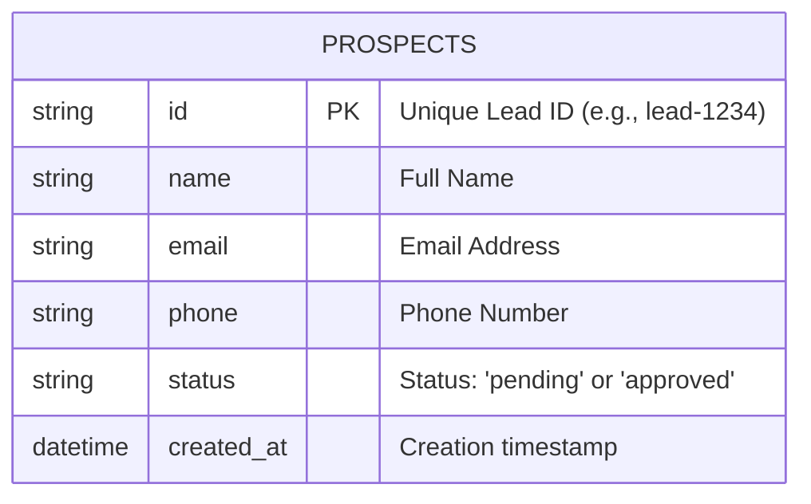

# QuestPage: Database Diagram

This database schema is designed to be brutally simple, matching the exact needs of the POC while providing the safety of SQLite for concurrent Webhook requests. We strictly avoid over-engineering (no complex joins or unnecessary tables).

## 🗄️ Entity-Relationship Diagram



## 📋 Table Definition (Raw SQL)

Since we are prioritizing speed and simplicity (No ORMs), the SQLite schema will be defined purely as:

```sql
CREATE TABLE prospects (
    id TEXT PRIMARY KEY,
    name TEXT NOT NULL,
    email TEXT,
    phone TEXT,
    status TEXT DEFAULT 'pending',
    created_at DATETIME DEFAULT CURRENT_TIMESTAMP
);
```

## 🔄 Data Flow
1. **Agent Simulator** sends `POST /api/prospects` -> INSERT INTO `prospects`.
2. **Dashboard** listens via SSE -> Selects rows where `status = 'pending'`.
3. **Human** clicks "Approve" -> `UPDATE prospects SET status = 'approved' WHERE id = ?`.
4. **Server** triggers Webhook -> Logs action to console.
